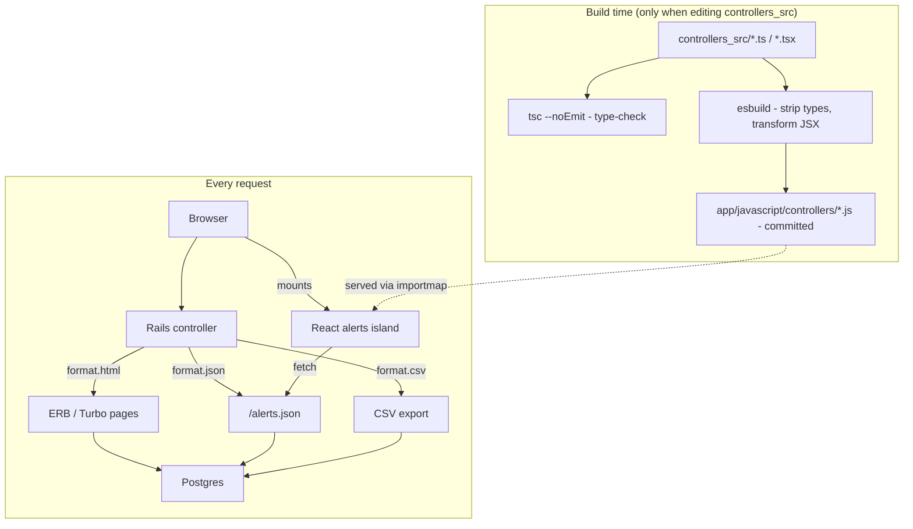

# Design Proposal

A bonus visual pass over the app, proposed before any app files change. Three concrete directions, same sample content in each so the only variable is the design itself. The rendered comparison is in the artifact; this file is the written record of what each one actually is.

No new dependencies in any of the three - hand-rolled CSS through the existing Sprockets pipeline (`app/assets/stylesheets/application.css`), consistent with this project's stance against adding a gem for something plain CSS already does.

## Option A — Quiet Ledger

A clean admin console: minimal, professional, reads like a well-made internal tool rather than a product.

- **Palette.** Cool slate-white paper (`#F6F7F9`), near-navy ink (`#1C2430`), one confident accent - a deep teal (`#146C5F`) that reads as "in stock" without reaching for literal green. Status: a muted brick red for open alerts, a muted green for resolved.
- **Type.** IBM Plex Sans for headings, Source Sans 3 for body text, IBM Plex Mono for counts and prices.
- **Layout.** A sticky top nav (Products / Stores / Brands / Alerts), content in bordered cards with soft shadows, tables sitting flush inside their card. Status shown as a small pill badge.
- **Where it fits.** Lowest risk, least opinionated of the three - the safe, correct-looking choice for a take-home submission.

## Option B — Stockroom Dashboard

More branded and warmer, like something a small retail chain's internal ops team would actually use day to day.

- **Palette.** Warm paper (`#FBF7F1`, closer to receipt stock than clinical white), warm ink-brown (`#2B2117`), a rust/amber accent (`#B5531C`) that reads as a warehouse stamp rather than a corporate blue.
- **Type.** Libre Franklin (bold, slightly condensed - a signage feel) for headings, Work Sans for body.
- **Layout.** Products/stores/brands render as a card grid instead of bare table rows - each one its own small tile. Status shown as a solid stamped chip with a dot, not a soft pill.
- **Where it fits.** More visual personality than Option A; closer to the "retail ops dashboard" category from the earlier round, now actually shown rather than named.

## Option C — Night Shift Console

Dark-mode-first, built for scanning a lot of rows fast - fitting, given the real data behind this app is 1,000,000 tracking events.

- **Palette.** Near-black charcoal-navy (`#0B0E12`), not pure black. A phosphor-green accent (`#39D98A`) for the general UI, a warm red (`#FF6B5E`) reserved for open alerts.
- **Type.** IBM Plex Mono for everything, headings included - a deliberate terminal/console feel rather than a typical CRUD-app look.
- **Layout.** Dense tables, minimal row padding. Alert status isn't a badge at all - it's a colored left-border bar on the row itself, like a log line.
- **Where it fits.** The most opinionated option. Best if the alert system (the app's actual headline feature) should visually dominate, at the cost of looking less like a conventional admin panel.
- **Correction from the mockup:** the artifact's first pass rewrote real product names into `snake_case` (`chocolate_frogs`) for the terminal aesthetic, and zero-padded tracking-event counts (`0892`) for the same reason. Both change the actual data on screen, not just its styling - a real product named "Chocolate Frogs" shouldn't display as something else, and a count of 892 isn't 0892, because of a theme choice. Both dropped from the mockup regardless of which option gets picked.

## What stays the same regardless of which one you pick

The same 4 sample products and 2 sample alerts (one ongoing, one resolved) appear in all three mockups, so the comparison is the design, not the data. Nothing in `app/` changes until one is picked - this file and the artifact are the proposal, not the implementation.

**Responsive layout is a requirement for whichever direction gets picked, not an extra.** "Viewable on mobile" was already settled earlier as a responsive-CSS question, independent of any framework choice - it belongs here as part of the actual scope, not left implicit.

## Beyond the visual layer

Five things worth architecting alongside the restyle, each with the actual database changes required, not just the feature description.

### Search

**Alerts are the highest-value filter target** - with 31,447 alerts, "show me open alerts for Brand X" is a real operational need. Name/address search is built on stores (address), products (name and brand, independently - both filled combines with AND), and brands (name) - each a page-flip saver at today's row counts (101/226/45), not a performance necessity, but real enough to build.

- **Alert status filter** (`?status=open` / `?status=resolved`): `where(resolved_at: nil)` / `where.not(resolved_at: nil)`. **Database changes: none** at today's scale - nothing filters or orders by `resolved_at` yet. If this needed to stay fast at higher volume, the fix is a partial index: `CREATE INDEX ON alerts (triggered_at) WHERE resolved_at IS NULL` - covers "open alerts, newest first" directly, and stays small regardless of how large the resolved-alert history grows, since it only indexes the open ones.
- **Store address / product name+brand / brand name search** (`WHERE column ILIKE ?`, value bound - not interpolated, so this isn't a SQL injection question at all): fine unindexed at 101/226/45 rows - a leading wildcard can't use a plain btree index anyway (Postgres can only range-scan a `LIKE 'term%'` prefix, not `%term%`), so a normal index wouldn't help here regardless of scale. The real issue is correctness, not security: a user searching for literal `50%` would have that `%` interpreted as a wildcard inside the pattern, matching anything starting with `50` rather than the literal string. `sanitize_sql_like` is the fix - it escapes `%`/`_` in the *user's* term before it's wrapped in the pattern - just for that reason, not injection. No submit button anywhere: a debounced Stimulus controller fetches and swaps in results as each field is typed into, so a full navigation per keystroke doesn't keep stealing focus from the search box. Products' two fields (name, brand) are independent and combine with AND when both are filled - the same controller reads every field's current value on each search, not just the one that just changed, so it generalizes to more than one field for free.
- **Database changes, at 100x scale**: a `pg_trgm` trigram index per searched column - `CREATE EXTENSION pg_trgm; CREATE INDEX ... USING gin (address gin_trgm_ops)` and similarly for `products.name`, `brands.name`. A genuinely different *kind* of index from anything else in this app today (everything existing is a plain btree) - named now so it isn't rediscovered from scratch later, the same way the counter-cache and keyset-pagination notes already are in `FINAL_PROPOSAL.md`.

### Sorting

Clicking a column header (e.g. "Tracking Events" on the products index) to sort by it. Available on every table, including alerts and the tracking-event lists - see "Sorting on keyset-paginated tables" below for how that works alongside keyset pagination.

- **Sorting by a stored column** (name, address, `triggered_at`): a plain `ORDER BY`. `products.name` and `stores.address` are already uniquely indexed; `alerts.triggered_at` has a `(triggered_at, id)` index, built for the keyset pagination below and reused here - no separate index needed for this.
- **Sorting by a computed count** (products by tracking-event count, brands by product count) is the harder case, worth naming the real tension rather than assuming a quick fix:
  - **Option 1 - live `JOIN` + `GROUP BY` + `ORDER BY`.** The real controller today runs two separate queries - the paginated `Product` list, and a *separate* `TrackingEvent.group(:product_id).count` into a Ruby hash the view looks up by id. Sorting by that count means combining these into one query (a join, grouped, with the count as an orderable column) - a genuinely different query shape, not the existing one just reordered. The cost is comparable to what's already being paid today (same aggregate, same table scan), but it is new code, not a free reorder. **Database changes: none.**
  - **Option 2 - a `counter_cache` column** (`products.tracking_events_count`). The textbook fix for "sort/filter by a count cheaply" - but not free here specifically, because of a tension already named in `CLAUDE.md`: Rails' `counter_cache` maintains itself via `after_create`/`after_destroy`, and this app's entire import performance story is built on `insert_all`, which skips callbacks entirely. A counter_cache column here needs a manual reconciliation step bolted onto the importer (a batch `UPDATE products SET tracking_events_count = (SELECT COUNT(*) ...)` after each import), not Rails keeping it in sync automatically. **Database changes: a new `integer, null: false, default: 0` column, plus an importer change to reconcile it - not just a migration.**
  - **Built as Option 1.** The join+group+order query was new code, but needed no new storage or reconciliation step, and its cost is comparable to what was already being paid today in a different shape. Revisit Option 2 only if the aggregate itself becomes the bottleneck independent of sorting - it already partially is (the documented 125ms / 84% `/products` cost in `IMPLEMENTATION_REPORT.md`).

#### Sorting on keyset-paginated tables

Alerts and the tracking-event lists combine sorting with keyset pagination. Every sortable column needs its own cursor - `KeysetPage` takes this as a parameter (direction, a qualified id column, and a value extractor for joined or computed columns) rather than requiring a hand-built mechanism per column. Alerts sort by brand, product, store, triggered-at, or status; status sorts on a computed boolean (`resolved_at IS NOT NULL`) rather than `resolved_at` itself, since `resolved_at` is NULL for every open alert and NULL never satisfies a keyset `<`/`>` comparison. Index pages (products/stores/brands) stay on plain offset pagination, sorted the ordinary way.

### Date range filtering, and tracking-event filters more generally

**Built**, on the product and store show pages' tracking-event lists: a `from`/`to` date range, an Inventory Present filter (yes/no), and - scoped to whichever dimension that page doesn't already fix - a Store filter on a product's page, a Product filter on a store's page. Sortable by Event Time, Inventory Present, and that same per-page dimension, using the same keyset mechanism alerts already uses (`DESIGN_REVIEWED_PROPOSAL.md` round 7's generalized `KeysetPage`).

- Implementation: `WHERE event_time >= ? AND event_time <= ?` for the range, scoped to the product or store already being viewed; plain equality for Inventory Present and the store/product filter.
- **Database changes: none.** The existing composite indexes (`[:product_id, :event_time, :id]`, `[:store_id, :event_time, :id]`) already have `event_time` as a middle column and `id` trailing - a range condition on `event_time`, within a fixed product or store, is still an index range scan on an index that already exists. One case where the indexing already in place happens to support the new feature for free.

### Pagination: keyset, not offset

`LIMIT 50 OFFSET N` gets slower the deeper a page is, because Postgres has to scan and discard every skipped row first. Alerts and the tracking-event lists use keyset pagination instead (`WHERE (sort_column, id) < (last_seen_value, last_seen_id) ORDER BY sort_column DESC, id DESC LIMIT 50`), so query cost stays flat no matter how many pages someone clicks through - "Previous"/"Next" links, 50 rows per page, each click a real page navigation.

**Database changes, built:**
- Products/stores/brands (ordered by name/address): none needed - already uniquely indexed, which is exactly what a keyset cursor needs to anchor on.
- Alerts (ordered by `triggered_at`): a new `(triggered_at, id)` index.
- Tracking events / price history (ordered by `event_time`, scoped to a product or store): the keyset cursor is `(event_time, id)`, so the index is `(store_id, event_time, id)` / `(product_id, event_time, id)` - `id` added as a trailing column to each existing composite index. The prior 2-column versions (`(store_id, event_time)` / `(product_id, event_time)`) got the scan most of the way there on their own, but didn't cover the `id` tiebreak for rows sharing the same `event_time` - without it, ties needed an extra sort step rather than a single fully-ordered index scan.
- Alerts sorted by brand, product, or store: **no supporting index exists for this one.** The keyset comparison needs an index spanning the joined table's name column and `alerts.id` together; `products.name` and `stores.address` are uniquely indexed on their own, `brands.name` isn't indexed at all, and neither composes with `alerts.id` across a join. Correct today (verified against real data), not a single ordered index scan - a join, sort, and limit instead. Fine at 31k alerts; worth a real index if this table's row count or sort-by-name traffic both grow a lot.

The GET-per-scroll question from `DESIGN_REVIEWED_PROPOSAL.md`'s round 1 applies directly here - every "Next" click on `/alerts` and the tracking-event lists is one. Round 1's measurement (single-digit milliseconds at this app's real row counts, regardless of offset) was taken against `LIMIT`/`OFFSET`; the keyset queries here are cheaper still, since their cost doesn't grow with depth at all.

#### Pagination vs. keyset (cursor): the actual tradeoff

| | Offset pagination (products/stores/brands) | Keyset / cursor pagination (alerts, tracking events) |
|---|---|---|
| Query cost at page N | Grows with N - scans and discards every skipped row | Constant, regardless of scroll depth |
| "Jump to page 12" | Yes | No - only next/previous from a cursor |
| Total page count ("page 3 of 40") | Cheap-ish (one extra `COUNT`) | Not naturally available at all |
| New indexes needed | None | One new index for `alerts`; `id` added as a trailing column to the existing tracking-event/price-history composite indexes; products/stores/brands reuse their existing unique indexes as-is |
| Correctness under concurrent writes | Can skip or repeat rows if the underlying set changes between page loads | Stable - a cursor anchored to a specific row is unaffected by rows inserted elsewhere |
| Implementation complexity | Lower | A cursor encode/decode step, and validating a client-supplied token instead of a trusted integer page number |

That "correctness under concurrent writes" row isn't just a performance difference. Offset pagination can skip or duplicate rows under concurrent inserts - a real correctness bug, not just a speed one.

Built on keyset pagination from the start, not `LIMIT`/`OFFSET`. The extra cost (one new index, a cursor encode/decode step) is small against inheriting a scaling problem already named and deferred once in `FINAL_PROPOSAL.md`, and then having to redo the work later anyway.

### CSV export

Exporting the current alert view back out as a CSV - fitting, given the whole app exists to *import* CSVs. **Database changes: none** - this reads the same filtered, sorted scope already built for the HTML view (see the `/alerts.json` data path above), not a separate export-specific query.

Built with `CSV.generate`, which holds the whole export as one string in memory before sending it - fine at today's row count, a real scaling limit worth naming now rather than rediscovering later: at a much larger `alerts` table, the fix is streaming the response (`response.stream`) row by row instead of building the whole string first, the same "name it now so it isn't rediscovered from scratch later" posture as the counter-cache and `pg_trgm` notes above.

Every exported field is also a formula-injection surface for whatever spreadsheet app opens it: a cell starting with `=`, `+`, `-`, or `@` gets run as a formula, not displayed as text. This app's data is fictional and controlled, so the real-world risk is low, but every exported value traces back to a brand/product/store name entered at import time, so each cell is prefixed with `'` when it starts with one of those four characters - one line, and it closes the gap regardless of how low-risk this particular dataset is.

All five were built, not just proposed as a "beyond the visual layer" wishlist - see Scope below for the complete list of what's live today.

## Pattern choices

A few suggestions came up for the pieces above. Here's the actual reasoning for each.

### Architecture at a glance

Two flows worth seeing together: what happens on every request (almost everything server-rendered, one React island as the exception), and what happens only when editing the TypeScript source (never at request time - the compiled output is committed).

The dotted edge is the only link between the two halves: the build step's output is a committed file, served like any other asset - nothing about handling a request ever invokes `tsc` or `esbuild`.

### Turbo Frames (Hotwire) vs. React

Live-applying filters and sortable columns without a full page reload need *some* client-side interactivity. The two real candidates:

| | Turbo Frames / Hotwire | React |
|---|---|---|
| New dependency | None - already in this app's importmap, unused | A full JS framework, plus a build step |
| Rendering model | Same as the rest of the app - server-rendered ERB, swapped in fragments | A second, parallel rendering model alongside the existing ERB views |
| Can it keep filters + sort + a cursor in sync without a reload | Yes - a GET form and links targeting the same frame do this declaratively, server-rendered each time, no client-side state to hand-patch | Yes, with its own client-side state and re-render |
| Consistency with the rest of the codebase | High - the whole app is server-rendered today | Low for most pages - a deliberate exception, not the default |

**React, scoped to the alerts filter UI, as deliberate groundwork, not a technical requirement.** Turbo Frames genuinely can do what the alerts filter UI needs - a GET form and links targeting the same frame keep status, brand, sort, and a cursor in sync without a reload, same as everywhere else in this app, no hand-patched DOM required. The real reason this one piece uses React: this project is expected to grow more complex client-side logic over time, and having React and TypeScript already wired in - the build step, the importmap pins, the pattern for mounting a component - pays off more as that happens, than waiting until a feature that "needs" it shows up. That's a legitimate reason to pick React here; "Turbo can't do this" wouldn't have been one. React is used in exactly this one place and nowhere else. The tracking-event filters auto-submit a real navigation on change (a small Stimulus controller just triggers it, nothing more); live store search is the one other place that updates without a reload, via its own debounced fetch-and-replace - real JS, but not a second rendering framework. Sort links and pagination stay plain server-rendered links everywhere.

**The alerts filter UI's data path.** The mounted React component fetches `GET /alerts.json` - the same `AlertsController#index` action the server-rendered page and the CSV export both use, with `format.json` added alongside `format.html` and `format.csv`. All three read the identical filtered, sorted scope built once at the top of the action, so there's no separate "API" code path to drift from what the page itself shows. The JSON response carries the rows plus the keyset cursor tokens the component needs to page forward/back - the same cursor shape `KeysetPage` already produces for the HTML view, just serialized instead of rendered. This is also the shape a future mobile client's API would start from, per the forward-looking note below - not built as an API today, but not a dead end either.

**React Native specifically** (raised separately, as "an easy path to a mobile app later") doesn't actually shorten that path the way it might seem to. React Native doesn't render React *web* views - there's no `
`/`<table>` in React Native, only native components (`<View>`, `<FlatList>`, etc.) - so a future native app's UI gets built from scratch regardless of what today's website uses. What *does* make a future native app easier is a clean JSON API underneath, which is a backend concern, independent of the website's rendering choice. See the forward-looking note below.

### Plain JavaScript vs. TypeScript

| | Plain JavaScript | TypeScript |
|---|---|---|
| New dependency | None - `importmap-rails` serves `app/javascript/**` straight to the browser | A compiler (`tsc`) plus a transform step (`esbuild`, for JSX) before anything can be served |
| Catches | Nothing before runtime | Type mismatches, typos in prop/field names, wrong argument counts - exactly the mistakes that are easy to introduce and easy to miss reviewing AI-generated diffs |
| What changes for importmap-rails | Nothing - files are served as-written | Still served as plain `.js` - source lives in `app/javascript/controllers_src/*.ts(x)`, compiled output lands where importmap already expects it |

**TypeScript, for the interactive controllers.** The honest cost: a build step that has to actually run (and its output committed or regenerated) for the interactive controllers to work at all - a new way for the app to be broken that the rest of this fully server-rendered app doesn't have. Worth it because it catches a real, recurring class of mistake - type errors and typos - before they reach the browser, which matters more than usual on AI-assisted code. The same build step also makes React, above, cheap to add on top, rather than two separate decisions each paying their own setup cost.

**The three questions a homemade build step raises, answered plainly** (a standard tool like `jsbundling-rails` would answer these the same way, just with less custom wiring - staying with the homemade version here since it's already built and tested, not because it's the better long-term choice if this grows further):
- **Is the compiled output committed?** Yes. `app/javascript/controllers/*.js` (compiled from `controllers_src/*.ts(x)`) is checked in like any other asset, not generated at deploy time.
- **How does React load - bundled or pinned from a CDN?** Neither exactly: it's vendored. `bin/importmap pin react react-dom/client` downloaded React's ESM build once into `vendor/javascript/`, and that local copy is committed and served by Sprockets - no CDN request at runtime, no bundling into one file either.
- **Does `bin/rails test` or a fresh clone need Node?** No, to run the app or the test suite - the compiled JS and vendored React are already committed, so `bundle install` and Postgres are all a fresh clone needs. Node and `npm install` are only needed to *edit* the TypeScript source and regenerate the compiled output (`npm run build`) - a dev-time tool, not a runtime dependency.

Committing the compiled output instead of generating it at deploy time raises a real risk: someone edits a `.ts`/`.tsx` file, forgets to rebuild, and commits stale `.js` with nothing to catch it - there's no CI on this repo. `test/build_controllers_test.rb` is that catch: it re-runs the actual build and fails if the result differs from what's committed, skipping (not failing) on a machine without Node, so the "Node not required" answer above stays true.

### Plain CSS (current) vs. Sass

| | Plain CSS (current) | Sass |
|---|---|---|
| New dependency | None - the existing Sprockets pipeline | `dartsass-rails`, or a Node build step |
| Theming mechanism | CSS custom properties - one token set, swapped per theme or per design option, already how all three options above and the house artifact style work | Variables + mixins - a different mechanism for the same job |
| What it would add here | - | Nesting, mixins - neither used by any of the three proposed designs |

**Declined for this project.** Sass earns its place when a stylesheet is complex enough that nesting and mixins meaningfully reduce duplication. None of the three design options need that - each is a single token set (palette plus two or three type roles) applied through CSS custom properties, which is already doing the real work (theme-swapping) in this app's existing artifacts. Adding a build-step dependency for authoring conveniences nothing here needs doesn't pay for itself.

### Postgres search (`ILIKE` / `pg_trgm`) vs. Elasticsearch

Named in "Search" above as the fix for name search at 100x scale: Postgres `ILIKE`/`pg_trgm`/full-text first, not Elasticsearch.

**Declined for this project.** Elasticsearch is a stronger tool, but for a bigger problem than this app has - relevance ranking, typo tolerance, and full-text search across millions of documents, not "find a product by part of its name" across a few tens of thousands of rows even at 100x scale. It's also a second system to run and keep in sync with Postgres, normally via save callbacks that this app's `insert_all`-based imports skip entirely - the same sync problem already named for `counter_cache`, and worse, since it means operating a whole second service rather than one Rails-maintained column. Worth it at millions of documents, or for fuzzy relevance tuning `pg_trgm` genuinely can't do - not at this app's scale. Full reasoning in `DESIGN_REVIEWED_PROPOSAL.md`, round 2.

## A forward-looking note

If a native iOS/Android app is a real possibility later, the highest-leverage thing to do isn't a frontend framework choice for the website - it's keeping controllers thin enough that a JSON API stays additive, not a rewrite. The first step already exists: `AlertsController#index` responds to `format.json` (`GET /alerts.json`) alongside `format.html` and `format.csv`, all three reading the identical filtered, sorted scope. The next step would be versioning it properly under a dedicated `Api::V1::` namespace once more than one controller needs this, rather than growing `format.json` branches across every action ad hoc. A native app (React Native or otherwise) would consume that API; it wouldn't consume today's ERB views either way, so nothing about the website's rendering choice helps or hurts that future path.

## Scope

Option A (Quiet Ledger), responsive, with an optional dark theme through the same CSS custom properties and `prefers-color-scheme` already used for theming; alerts filters (open/resolved, and by brand); sorting on every table, including alerts and the tracking-event lists (and, on the store show page specifically, Brand too, linked to its own page); filtering on the tracking-event lists (inventory present, a date range, and a store/product dimension); live search, no submit button, on stores (address), products (name and brand, independently), and brands (name); keyset pagination on alerts and the tracking-event lists; CSV export of alerts.
