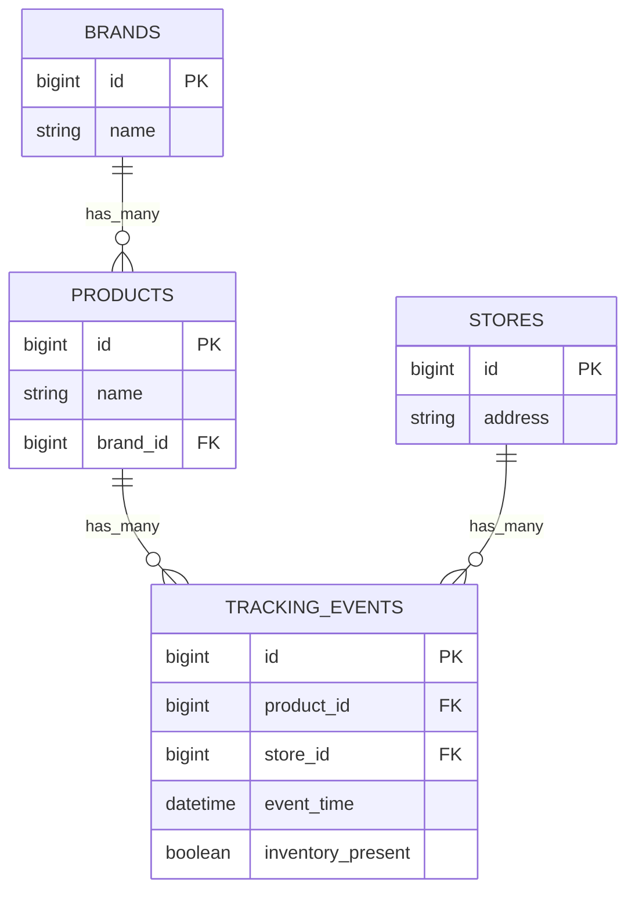
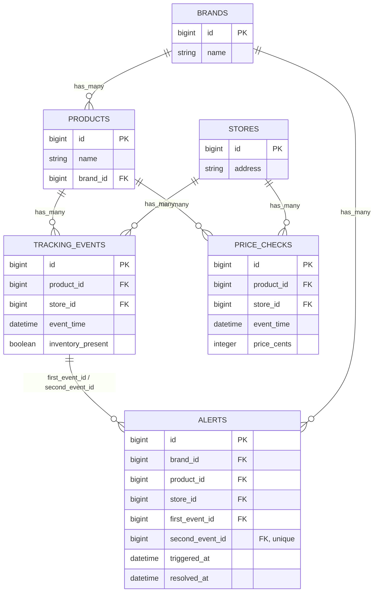
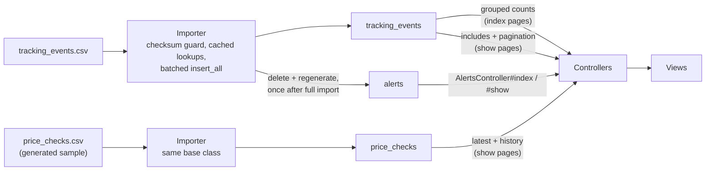

# Final Proposal

**5 bugs fixed** · **1 alert generator, wired in** · **4 diagrams** · **~44s end-to-end, measured** · **~51.6x faster import**

Everything in this document reflects the final, corrected design after fourteen rounds of independent review in `REVIEWED_PROPOSAL.md`. Where that document shows the process — including the mistakes caught along the way — this one states only the destination.

## Objectives

The README sets three objectives. Restating each, with the approach taken:

**Objective 1 — Price tracking.** The README: "an inventory check and a price check are separate and can occur without the other." The existing system only tracks inventory presence. Price tracking is added as an independent capability — a separate `price_checks` table and importer, not a column bolted onto the existing event table.

**Objective 2 — Alert system.** The README asks for an alert "if a store has two 'no inventory' events in a row for the same product," based on `event_time`, with just a basic index and show page. Implemented as a set-based query over actual chronological order — not insertion order — one alert per streak rather than per pair, surfaced through a dedicated `AlertsController`.

**Objective 3 — Performance.** The README asks for a measurable improvement with an explanation of where it came from. Addressed in both the import path (row-by-row to batched `insert_all`) and the read paths (N+1 queries replaced with grouped counts and pagination) — both sections below carry real, measured before/after numbers.

## Bugs, and how to fix them

All five live in `app/services/tracking_events/csv_importer.rb`. None of them were visible on the first run because that run never hit malformed values or name/address collisions — though it did already contain the same-day duplicate-check complexity bug #1's fix has to get right.

1. **Re-running the import duplicates every row.** Not fixed with a row-level unique index — `event_time` is day-only, and 55,308 real same-day `(product, store)` groups exist, 18,062 with genuinely conflicting readings. A unique constraint would silently drop real data. Fixed at the file level instead: a `csv_imports` table tracks each file's checksum, so re-running on an already-imported file is a no-op.
2. **One bad row kills the entire import.** Each row is now rescued individually; a bad date or failed lookup is logged and skipped rather than aborting the whole run. A structurally broken file — not a bad value, but malformed CSV syntax itself — is a different failure mode: `CSV::MalformedCSVError` is raised by the iterator, not from inside a row, so it isn't caught by the per-row rescue and the whole transaction rolls back. That's a stated decision, not an oversight — a file broken at that level warrants stopping, not silently skipping rows around it.
3. **`find_by` on name/address.** Confirmed hypothetical for the current dataset (every name and address is unique, zero collisions) — kept as hardening, not because it's failed, but because nothing in the schema guarantees it won't. Lookups are cached in a hash before the loop starts, which also removes ~2,000,000 redundant queries.
4. **No explicit CSV encoding.** Confirmed real, not hypothetical — 83,020 of 1,000,001 lines contain a non-ASCII byte (e.g. `Nobleman's Wine Reserve`'s curly apostrophe). Fixed with `encoding: "bom|utf-8"`.
5. **Silent boolean coercion.** An unrecognized `Inventory Present` value now raises instead of defaulting to `false`, so a data-quality problem can't masquerade as a real "no inventory" reading.

All five live in one importer, batched for performance (see Objective 3 below):

The `exists?` check and the unique index on `checksum` both assume one import runs at a time. Two concurrent runs of the same file would both pass the check, both do the full batched insert, and only collide when the second one tries to write its `CsvImport` row — which doesn't corrupt data (the whole transaction rolls back), but wastes a full import's worth of work and raises instead of exiting cleanly. An advisory lock, held for the transaction's duration, serializes that instead of letting it race:

```ruby
IMPORT_LOCK_ID = Zlib.crc32("tracking_events_import")
BATCH_SIZE = 5_000

def call
  checksum = Digest::SHA256.file(@path).hexdigest
  return if CsvImport.exists?(checksum: checksum)

  stores_by_address = Store.all.index_by(&:address)
  products_by_name  = Product.all.index_by(&:name)
  batch = []
  created_count = 0
  skipped_count = 0

  ActiveRecord::Base.transaction do
    ActiveRecord::Base.connection.execute("SELECT pg_advisory_xact_lock(#{IMPORT_LOCK_ID})")
    next if CsvImport.exists?(checksum: checksum) # another run may have just finished while this one waited

    CSV.foreach(@path, headers: true, encoding: "bom|utf-8") do |row|
      begin
        store   = stores_by_address[row["Address"]]
        product = products_by_name[row["Product Name"]]
        unless store && product
          skipped_count += 1
          next
        end

        batch << {
          store_id: store.id,
          product_id: product.id,
          event_time: Date.parse(row["Date"]),
          inventory_present: cast_boolean(row["Inventory Present"])
        }
        created_count += 1

        if batch.size >= BATCH_SIZE
          TrackingEvent.insert_all(batch)
          batch.clear
        end
      rescue ArgumentError => e
        skipped_count += 1
        Rails.logger.warn("[CsvImporter] skipped row: #{e.message}")
      end
    end

    TrackingEvent.insert_all(batch) if batch.any?
    CsvImport.create!(checksum: checksum, row_count: created_count)
  end

  Rails.logger.info "[CsvImporter] created=#{created_count} skipped=#{skipped_count}"
end

def cast_boolean(value)
  case value
  when true, "true", "TRUE", "t", "T", "1", "True" then true
  when false, "false", "FALSE", "f", "F", "0", "False", nil, "" then false
  else raise ArgumentError, "Unrecognized inventory value: #{value.inspect}"
  end
end
```

## Improper code, and how it's cleaned

### Data integrity

Every model gets presence/uniqueness validations, and every migration sets `null: false` on the columns every view and importer already treat as required. `Product#name` is **globally** unique, not scoped to `brand_id` — `tracking_events.csv` has no brand column, so the importer's `index_by(&:name)` can only ever resolve a product by name alone; a brand-scoped validation would let through exactly the ambiguity the importer can't handle. Backed by real indexes, not just validations, since `insert_all` skips validations entirely:

```ruby
validates :name, presence: true, uniqueness: true    # Product
validates :address, presence: true, uniqueness: true # Store
```

```ruby
add_index :products, :name, unique: true
add_index :stores, :address, unique: true
```

### Alerts

One alert per **streak**, not per pair — a 3-in-a-row would otherwise fire twice for one outage. Computed directly from `tracking_events` with a window function; no intermediate counter table, so it works identically whether rows arrive one at a time or in a bulk batch:

```sql
INSERT INTO alerts (brand_id, product_id, store_id, first_event_id, second_event_id, triggered_at, resolved_at, created_at, updated_at)
SELECT p.brand_id, t.product_id, t.store_id, t.first_event_id, t.id, t.event_time, resolved.event_time, now(), now()
FROM (
  SELECT id, product_id, store_id, event_time, inventory_present,
         LAG(id) OVER w AS first_event_id,
         LAG(inventory_present, 1) OVER w AS prev1,
         LAG(inventory_present, 2) OVER w AS prev2
  FROM tracking_events
  WINDOW w AS (PARTITION BY product_id, store_id ORDER BY event_time, id)
) t
JOIN products p ON p.id = t.product_id
LEFT JOIN LATERAL (
  SELECT te.event_time
  FROM tracking_events te
  WHERE te.product_id = t.product_id AND te.store_id = t.store_id
    AND te.inventory_present = true
    AND (te.event_time, te.id) > (t.event_time, t.id)
  ORDER BY te.event_time, te.id
  LIMIT 1
) resolved ON true
WHERE t.inventory_present = false AND t.prev1 = false AND t.prev2 IS DISTINCT FROM false;
```

Measured against the real 1,000,000-row dataset: **31,447 alerts**, of which 30,572 resolve automatically and 875 are still ongoing.

This only has any effect if something actually runs it. The importer triggers it **once, after the full import, inside the same transaction** — not per batch. Doing it per batch was tried and measured: 200 batches × ~4,492 distinct pairs touched per batch (the CSV is shuffled across all 22,826 pairs) is ~898,400 individual regeneration calls, each cheap (~5.8ms, measured) but ~87 minutes in aggregate — worse than the import this project exists to speed up. One regeneration at the end is a single set-based statement instead:

```ruby
# after the final insert_all, still inside the transaction
Alert.delete_all
AlertGenerator.new.call
```

The per-pair version isn't wrong — it's the right tool for a single late-arriving event, which only ever touches one pair. Its full SQL was never written out anywhere above, only referenced by its call signature — worth specifying now, with bind parameters rather than interpolation, since this is exactly the code that gets wired to a request parameter someday. The bulk version above is static SQL with no external input, so it's safe as written; the per-pair version takes `product_id`/`store_id` as input and needs to stay parameterized even though today those values only ever come from this app's own database, never a user:

```ruby
# AlertGenerator.new(product_id:, store_id:).call — used for one late event, not for a bulk import
def call
  Alert.where(product_id: product_id, store_id: store_id).delete_all

  ActiveRecord::Base.connection.exec_query(<<~SQL, "AlertGenerator", [product_id, store_id])
    INSERT INTO alerts (brand_id, product_id, store_id, first_event_id, second_event_id, triggered_at, resolved_at, created_at, updated_at)
    SELECT p.brand_id, t.product_id, t.store_id, t.first_event_id, t.id, t.event_time, resolved.event_time, now(), now()
    FROM (
      SELECT id, product_id, store_id, event_time, inventory_present,
             LAG(id) OVER w AS first_event_id,
             LAG(inventory_present, 1) OVER w AS prev1,
             LAG(inventory_present, 2) OVER w AS prev2
      FROM tracking_events
      WHERE product_id = $1 AND store_id = $2
      WINDOW w AS (PARTITION BY product_id, store_id ORDER BY event_time, id)
    ) t
    JOIN products p ON p.id = t.product_id
    LEFT JOIN LATERAL (
      SELECT te.event_time FROM tracking_events te
      WHERE te.product_id = t.product_id AND te.store_id = t.store_id
        AND te.inventory_present = true
        AND (te.event_time, te.id) > (t.event_time, t.id)
      ORDER BY te.event_time, te.id LIMIT 1
    ) resolved ON true
    WHERE t.inventory_present = false AND t.prev1 = false AND t.prev2 IS DISTINCT FROM false
    ON CONFLICT (second_event_id) DO NOTHING;
  SQL
end
```

Plain values in the binds array (`[product_id, store_id]`) rather than the older `[[nil, value], ...]` tuple form — both are parameterized and safe, but the plain form is what Rails 7.1 actually expects; confirmed directly against this app's Rails 7.1.6 by running `exec_query` with an injection-shaped string in place of a real value and checking the target table was untouched afterward.

```ruby
# lib/tasks/alerts.rake — for ad hoc regeneration outside an import
namespace :alerts do
  desc "Regenerate all alerts from tracking_events"
  task generate: :environment do
    Alert.delete_all
    AlertGenerator.new.call
  end
end
```

The README asks for "a basic index and show page like the rest of the app":

```ruby
# routes.rb
resources :alerts, only: [:index, :show]
```

As proposed, `#index` loaded all 31,447 alerts on one page — the same unbounded-page problem already fixed on the product and store show pages, just reintroduced in the controller built to fix a different one. Paginated with the same `limit`/`offset` pattern used everywhere else:

```ruby
class AlertsController < ApplicationController
  def index
    page = params[:page].to_i.clamp(1..)
    @alerts = Alert.includes(:brand, :product, :store)
                   .order(triggered_at: :desc)
                   .limit(50).offset((page - 1) * 50)
  end

  def show
    @alert = Alert.includes(:brand, :product, :store).find(params[:id])
  end
end
```

Plus one line on the brand show page, since alerts are "to the brand" — needs `has_many :alerts` on `Brand`, easy to forget since nothing else on that model required it before now:

```ruby
class Brand < ApplicationRecord
  has_many :products
  has_many :alerts
end
```

```erb
<%= pluralize(@brand.alerts.where(resolved_at: nil).count, "open alert") %>
```

### Price data

No price column exists in the current CSV, so this is a stated assumption, not an implicit gap: price checks arrive via a second CSV (`price_checks.csv`, with a small generator task producing sample data) and a second, parallel importer — mirroring the inventory-check path exactly rather than inventing a new pattern. The point of tracking it is to show it, so both the product and store show pages get the latest reading plus a short history:

```ruby
@latest_price  = @product.price_checks.order(event_time: :desc).first
@price_history = @product.price_checks.order(event_time: :desc).limit(10)
```

Indexed the same way as `tracking_events`, since both show pages order by `event_time`:

```ruby
add_index :price_checks, [:product_id, :event_time]
add_index :price_checks, [:store_id, :event_time]
```

### Performance & queries

Index pages use a single grouped-count query instead of eager-loading every associated row — for all three resources, not just products:

```ruby
# products_controller.rb
@products = Product.includes(:brand)
@counts   = TrackingEvent.group(:product_id).count

# stores_controller.rb
@stores = Store.all
@counts = TrackingEvent.group(:store_id).count

# brands_controller.rb
@brands = Brand.includes(:products)
@counts = TrackingEvent.joins(:product).group("products.brand_id").count
```

Show pages (both products and stores — the original pass only covered stores) are paginated with plain `limit`/`offset`, no new dependency, and eager-load through the association that was actually causing the N+1:

```ruby
page = params[:page].to_i.clamp(1..)
@events = @store.tracking_events.includes(product: :brand)
                 .order(event_time: :desc)
                 .limit(50).offset((page - 1) * 50)
```

Indexes match how the data is actually read, replacing the two single-column foreign-key indexes entirely — a composite index's leading column already covers what the single-column one did, so keeping both is pure redundancy. The three-column index also carries a trailing `id` so the alert query's window function can read directly off the index's order instead of sorting 1,000,000 rows at runtime:

```ruby
add_index :tracking_events, [:store_id, :event_time]
add_index :tracking_events, [:product_id, :event_time]
add_index :tracking_events, [:product_id, :store_id, :event_time, :id]
# no separate single-column index on product_id or store_id — redundant once the above exist
```

Measured, not estimated: the store with the most events (10,167) went from **20,341 queries / 5,946.9ms** to **3 queries / 26.3ms** rendering its show page — roughly 230x faster, and the query count drops from two-per-event to a fixed three regardless of how many events exist.

### Coverage, style & structure

Tests prioritize the alert window logic — out-of-order arrival, same-day ties, a price check landing mid-streak, re-import idempotency — over model validations, since that's where the risk actually is. The inventory and price importers share a small base class for the checksum guard, batching, and lookup caching, rather than duplicating that logic twice. `db/seeds.rb` deletes in dependency order with `delete_all`, including the new `alerts` and `price_checks` tables:

```ruby
Alert.delete_all
PriceCheck.delete_all
TrackingEvent.delete_all
Product.delete_all
Store.delete_all
Brand.delete_all
```

## Current system design, and suggested revisions

### Today

Before the objectives: what's actually committed right now. Four tables, two foreign-key indexes, a single CSV importer with no caching or batching, and controllers that N+1 on every page.




No price tracking, no alerts, no pagination, no composite indexes. This is the starting point the rest of this section revises.

### Final design

`tracking_events` stays exactly as it is today (no renaming, no `kind` column — Alternative B's full separation won, and renaming a 1,000,000-row table would have bought nothing). One new table alongside it, and one real difference from the first draft: there is no `product_store_statuses` table. The running-counter design that both of the first draft's alternatives relied on couldn't survive its own performance recommendation — a bulk `insert_all` skips the `after_create` callback that counter depended on — so alerts are computed directly from the event tables instead, with no intermediate state to keep in sync.

A `product_stores` join table (one row per product/store pair, ~22,800 rows) was considered as a cleaner home for per-pair state and a natural place to put "current status" if that need ever came back. Not building it — it means restructuring the 1,000,000-row event table and adding a join to every read, for a benefit none of the three objectives actually need. Worth revisiting if per-pair state grows beyond what a direct query handles well.



### Data & request flow



**After, measured twice:** separate scratch-table benchmarks put the batched import at 34.99s and the bulk alert pass at 19s (~54s added together). Once actually built and run end-to-end for real — `bin/rails tracking_events:import` against the real schema, real indexes and FKs, real 1,000,000-row file — the combined number came in at **~44 seconds** (four runs: 41.3s, 43.2s, 44.6s, 45.0s), better than the sum of the two separate benchmarks. **Before, extrapolated:** ~30.1 minutes, projected from a 100,000-row row-by-row run under the same conditions — not measured end-to-end, since that would take the better part of an hour to re-confirm something already established. The import step alone is **~51.6x faster**; alert generation runs automatically as part of every import rather than needing to be invoked by hand, or — as an earlier draft of this document got wrong — run once per batch, which measured out to roughly 87 minutes, worse than not optimizing the import at all.

## Out of scope

Not required by the brief, and not built — named explicitly as boundaries, not oversights, and checked rather than assumed.

### Already holds up

**Fault tolerance** — better than it looks, just not labeled as such. The checksum guard plus the single-transaction import gives idempotency for free: a crash mid-import commits nothing, so retrying from scratch is always safe. The malformed-CSV behavior is a stated decision, not a gap.

**Security** — checked specifically, not assumed: nothing in the proposed code interpolates untrusted input into SQL (`insert_all`, `Alert.where(...)`, and both generator queries are parameterized or take no external input). The app is read-only over HTTP, so there's no mass-assignment surface and minimal CSRF exposure. ERB escapes output by default, and nothing calls `raw`/`html_safe` on user-sourced strings like product names, so XSS isn't a concern as written. Pagination's `params[:page].to_i.clamp(1..)` is already safe against bad input. The importer reads a fixed path under `Rails.root`, never a user-supplied one. Secrets are handled correctly: `config/master.key` is gitignored, the production database password comes from an environment variable, and `force_ssl` is on in production. None of the data is real — stores, brands, and products are all fictional, so there's no actual PII to protect yet.

### Named, not built

**Authentication and authorization.** The one an interviewer will ask about. Alerts go "to the brand," so in a real system a brand user should see only their own alerts — right now, anyone can open `/alerts/123` for any brand. In production, alerts would be scoped to the current user's brand (`current_brand.alerts.find(id)`), with an authorization layer such as Pundit. Not built, since the app has no users or login at all.

**CSV uploads, if added later.** The importer currently reads a fixed file from disk. If that ever becomes a user-facing upload instead of an ops-run rake task, it needs size limits, content-type checks, and to run as a background job rather than inline — the same "no queue yet" point below, with an actual attacker-controlled file behind it this time.

**Multi-region availability, read replicas, table partitioning.** Not needed at this scale, named so the absence reads as a decision rather than something unexamined.

### At 100x throughput

Two things are sized for 1,000,000 rows specifically and would need to change at meaningfully larger scale:

**Alert generation regenerates the whole table.** The bulk window-function pass (19s at 1,000,000 rows) scans and sorts all of `tracking_events` every time it runs. At 100x the data, that's not just 100x the time — a sort over a much larger partition set risks spilling past `work_mem` and running worse than linear. The per-pair generator, already built for single late events, is the actual scalable pattern: at real throughput, alert generation should be incremental — process only the pairs touched since the last run — not "delete everything, regenerate everything" as a recurring bulk job.

**The import is one all-or-nothing transaction.** Correct at this scale: it gives idempotency and a cheap retry path for free, and a sub-minute import makes "just restart" the right failure mode. At 100x the data, a multi-hour transaction becomes a liability independent of whether it succeeds — long-running transactions block autovacuum across the whole database, not just the table being written. Sustained high-volume ingestion would need checkpointed, resumable batches instead of one giant transaction.

**No background jobs, no Redis.** Both the import and alert generation run synchronously and inline right now — correct here, since nothing is waiting on a web request and the whole thing finishes in under a minute. This app has no queue adapter configured at all (`config.active_job.queue_adapter` is unset), so there's nothing to add scope to yet. That stops being true the moment ingestion runs from a web upload, on a schedule, or doesn't fit in a request timeout — at which point a queue moves the work off whatever triggers it. Worth being precise about what that actually requires: a queue doesn't require Redis — a DB-backed one (Solid Queue, added as a gem; it's the Rails 8 default, not 7.1's) handles this without a new piece of infrastructure. Redis specifically would only earn its place for two things this doesn't need yet: a Sidekiq-style queue if a DB-backed one's throughput isn't enough, or a cache in front of the grouped-count reads if read volume grew large enough that hitting Postgres for every index page became the bottleneck. Neither applies at today's scale.

That's not true of all of it, and it's worth being exact about where the line actually is. The composite indexes genuinely scale with what's read. The grouped counts and the offset pagination don't:

**Grouped counts scan the whole table, every page view.** `TrackingEvent.group(:product_id).count` has to touch every row in `tracking_events` to produce a correct per-product count, no matter how many products are shown on one page — cost grows with total data volume, not with the page being rendered. At 100x the data, this is the thing to fix first: precompute the counts during import (a `tracking_events_count` counter_cache column, reconciled per batch the same way anything bulk-inserted has to be) instead of aggregating live on every request.

**Offset pagination gets slower on deep pages.** `LIMIT 50 OFFSET N` makes Postgres scan and discard the first N rows before it can return anything — cost grows with how far into the result set a page is, not with the 50 rows actually shown. At 100x the data, switching to keyset pagination on `(event_time, id)` — `WHERE (event_time, id) < (last_seen_event_time, last_seen_id) ORDER BY event_time DESC, id DESC LIMIT 50` — keeps every page's cost constant regardless of depth, using the same composite index already in place.

The indexes are the one part of this section that's genuinely scale-invariant as written; the other two read-path fixes are correctly sized for 1,000,000 rows, not for 100x that.
