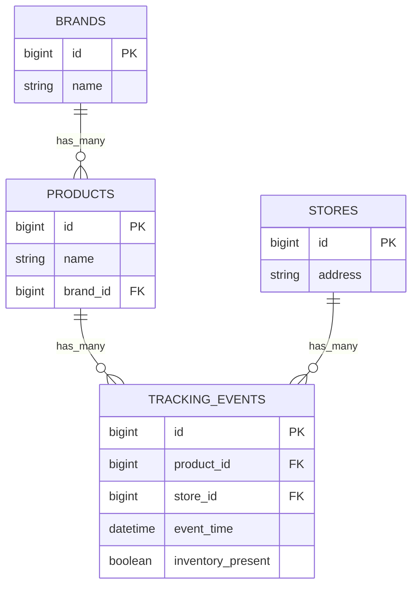
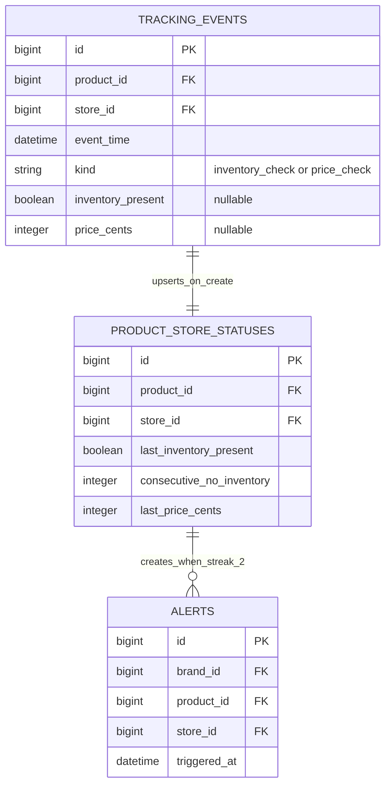
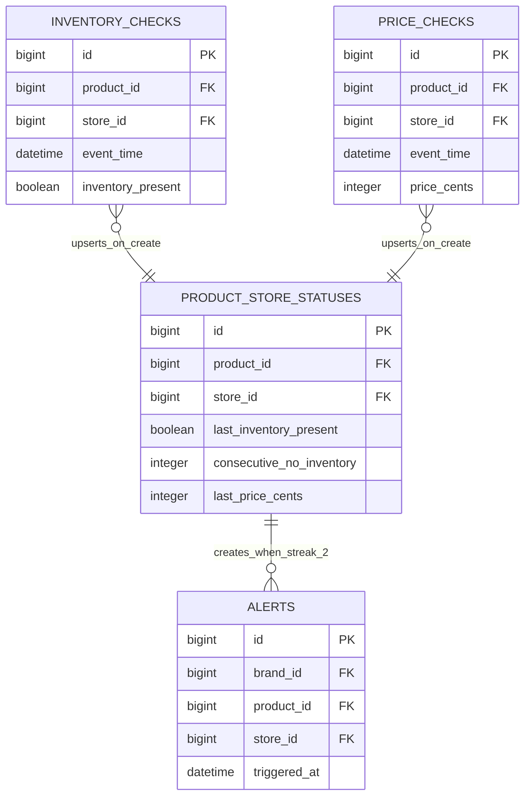
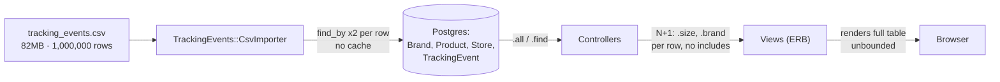
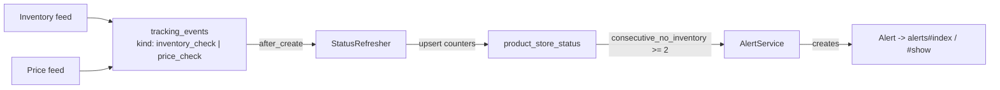
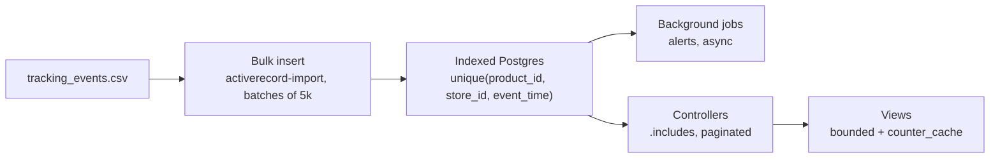

# Review Notes

**5 bugs** · **11 cleanup items** · **6 diagrams** · **1,000,000 rows in the dataset**

## Objectives

Here's the exercise, in plain terms:

**Objective 1 — Price tracking.** Right now this thing can tell you whether a product is on the shelf, and that's it — nothing about what it costs. Add price tracking as its own capability. An inventory check and a price check are two different kinds of event; they don't happen together, and they shouldn't be modeled as if they do.

**Objective 2 — Alert system.** Build an alert: when a store logs two "no inventory" events in a row for the same product — in actual chronological order, not the order the rows happened to be created — raise an alert to that product's brand. Keep the UI minimal; an index and a show page, same as the rest of the app, is plenty.

**Objective 3 — Performance.** Make it fast. Fold this into the first two objectives or do it as its own pass afterward — I don't mind which. I just want a measurable improvement, and I want to hear you explain where it came from.

## Bugs, and how to fix them

All five live in the same place: `app/services/tracking_events/csv_importer.rb`, the service that loads the 1M-row CSV. None of them are visible yet because the import has only ever been run once, start to finish, on clean data — exactly the conditions under which they'd stay hidden.

### 1. Re-running the import duplicates every row

`csv_importer.rb:25`

Nothing uniquely constrains a `(product_id, store_id, event_time)` triple, so a second run of the rake task doesn't update or skip existing events — it inserts a second full copy. Every count on every page silently doubles, and any "two events in a row" alert logic built on top of this data breaks.

```ruby
# migration
add_index :tracking_events,
          [:product_id, :store_id, :event_time],
          unique: true

# csv_importer.rb
TrackingEvent.find_or_create_by!(
  store: store, product: product, event_time: event_time
) do |event|
  event.inventory_present = inventory_present
end
```

### 2. One bad row kills the entire 1M-row import

`csv_importer.rb:22`

`Date.parse` and `create!` run with no rescue. A single unparsable date or failed validation raises, the rake task dies mid-run, and — combined with the bug above — re-running it then duplicates everything that already made it in.

```ruby
CSV.foreach(@path, headers: true) do |row|
  row_count += 1
  begin
    store   = stores_by_address[row["Address"]]
    product = products_by_name[row["Product Name"]]
    next unless store && product

    event_time = Date.parse(row["Date"])
    TrackingEvent.find_or_create_by!(...)
    created_count += 1
  rescue ArgumentError, ActiveRecord::RecordInvalid => e
    Rails.logger.warn("[CsvImporter] row #{row_count}: #{e.message}")
  end
end
```

### 3. `find_by` on name/address can match the wrong record — and costs 2 queries per row

`csv_importer.rb:16-17`

Lookups assume product names and store addresses are globally unique; nothing in the schema enforces that, so a collision silently misattributes events. The same two calls also run once per CSV row with no caching — two million uncached queries for a 1M-row file, which is a large part of why the import took roughly 30 minutes in this environment.

```ruby
# load once, outside the loop
stores_by_address = Store.all.index_by(&:address)
products_by_name  = Product.all.index_by(&:name)

# and enforce the assumption at the model layer
validates :name, presence: true, uniqueness: { scope: :brand_id } # Product
validates :address, presence: true, uniqueness: true              # Store
```

### 4. No explicit CSV encoding

`csv_importer.rb:13`

The seed/tracking data contains non-ASCII characters (curly apostrophes in product names). On a host without a UTF-8 locale — common on minimal production or CI images — `CSV.foreach` raises on the first affected row instead of reading it.

```ruby
CSV.foreach(@path, headers: true, encoding: "bom|utf-8") do |row|
```

### 5. `cast_boolean` turns unrecognized values into a silent "false"

`csv_importer.rb:40-45`

Any blank cell, typo, or unexpected spelling falls through to `false` — indistinguishable from a genuine "no inventory" reading. That's risky on its own, and actively dangerous once the alert feature fires on repeated "no inventory" events.

```ruby
def cast_boolean(value)
  case value
  when true, "true", "TRUE", "t", "T", "1", "True" then true
  when false, "false", "FALSE", "f", "F", "0", "False", nil, "" then false
  else
    raise ArgumentError, "Unrecognized inventory value: #{value.inspect}"
  end
end
```

## Improper code, and how to clean it

Nothing here is broken yet — the app works on the current, small, well-behaved dataset. These are the places where "works today" and "works under evaluation / at scale" diverge.

### Data integrity

**None of the four models declare a validation** — `app/models/*.rb`

No presence or uniqueness checks on `Brand`, `Product`, `Store`, or `TrackingEvent`. Bad data is only ever caught (or not) by whatever imported it.

```ruby
class Store < ApplicationRecord
  has_many :tracking_events
  validates :address, presence: true, uniqueness: true
end
```

**Migrations never set `null: false` on required columns** — `db/migrate/*.rb`

`brands.name`, `products.name`, `stores.address`, `tracking_events.event_time` all permit NULL at the database layer despite every view and the importer treating them as always present.

```ruby
change_column_null :stores, :address, false
change_column_null :tracking_events, :event_time, false
```

### Performance & queries

**Every index page is an N+1** — `products_controller.rb`, `brands_controller.rb`, `stores_controller.rb`

`/products`, `/brands`, and `/stores` each load `Model.all` and then call an association method (`.brand`, `.products.size`, `.tracking_events.size`) per row with no `includes` — one extra query per row, per association.

```ruby
@products = Product.includes(:brand, :tracking_events)
@brands   = Brand.includes(products: :tracking_events)
@stores   = Store.includes(:tracking_events)
```

**Show pages render the full `tracking_events` table, unbounded** — `views/products/show.html.erb`, `views/stores/show.html.erb`

A popular product or store can accumulate tens of thousands of events out of the 1M-row dataset. The show page renders every one of them in a single HTML table with no limit or pagination.

```ruby
@events = @product.tracking_events
                   .order(event_time: :desc)
                   .page(params[:page]) # Kaminari / Pagy
```

**No index on `event_time`** — `db/migrate/..._create_tracking_events.rb`

`tracking_events` — by far the largest table, and the only one with a real time dimension — indexes just the two foreign keys. Any "last N days" or "latest check" query has to scan the full table.

```ruby
add_index :tracking_events, [:product_id, :store_id, :event_time]
```

### Coverage, style & structure

**Zero executable test coverage** — `test/**`

All four model test files are untouched Rails stubs, there are no controller tests, and fixtures are empty. `rails test` currently "passes" by running nothing.

```ruby
test "store requires an address" do
  store = Store.new(address: nil)
  assert_not store.valid?
end
```

**Models use 4-space indent; everything else uses 2** — `app/models/*.rb`

Every controller and view in the app uses the Ruby/Rails-standard 2-space indent except the four model files. There's no `.rubocop.yml` to catch this.

```
bundle exec rubocop -a   # or rails-omakase / standard, then re-indent by hand
```

**No centralized error handling** — `app/controllers/application_controller.rb`

`ApplicationController` is empty. A bad id on any resource raises `ActiveRecord::RecordNotFound` with Rails' default behavior; adding a friendly 404 later means touching three controllers instead of one.

```ruby
class ApplicationController < ActionController::Base
  rescue_from ActiveRecord::RecordNotFound, with: :render_not_found

  private

  def render_not_found
    render file: Rails.public_path.join("404.html"), status: :not_found
  end
end
```

## Current system design, and suggested revisions

### Database schema

**Today's schema** — four tables, two foreign-key indexes, no uniqueness or null constraints anywhere, and no concept of price or alerts yet.



**Alternative A — minimal structural change.** `brands`/`products`/`stores` are untouched; `tracking_events` gains a `kind` discriminator and a nullable `price_cents`, and a new `product_store_statuses` row is kept current on every insert so `alerts` never has to re-scan history.



**Alternative B — fully normalized.** Inventory and price checks are physically separate tables rather than one table with a `kind` flag; both still roll up into the same `product_store_statuses` row. Cleaner relationally, at the cost of two tables/migrations and two importer paths instead of one.



For a project with a stated 2–3 hour scope, **Alternative A** is the pragmatic pick — one migration, one importer path, related checks still live together. Alternative B is worth a line in your own notes as "the direction if this table kept growing," but implementing it here would spend time the brief doesn't budget for.

### Data & request flow

**Today** — a synchronous, row-by-row importer with two uncached lookups per CSV row, feeding a schema with no uniqueness or null constraints, read by controllers that N+1 on every index and show page.



**Alternative — typed events + a maintained status row.** Inventory and price checks land as distinct, independent events; a small per-(product, store) status row tracks the running streak, so the alert check is an O(1) lookup instead of re-scanning history on every event.



**Alternative — bulk load + async + indexed reads.** Replacing row-by-row `create!` with a batched bulk insert removes roughly 2,000,000 uncached lookup queries. This session's own measured import rate — about 550 rows/sec, roughly 30 minutes for 1,000,000 rows — is the real before number worth citing against whatever a bulk-insert pass measures.


